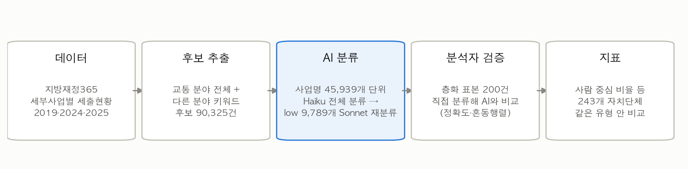

# 사람 중심 이동, 예산은 어디까지 왔나

AI로 분류한 전국 243개 지자체 교통예산 진단

전국 지방자치단체의 세부사업 세출에서 교통 관련 사업을 골라 AI(Claude)로 8개 범주로 분류하고, 지자체별 교통예산이 **자동차 통행 용량 확대**와 **사람 중심 교통(대중교통·보행·자전거·교통약자)** 중 어디에 쓰이는지 지표로 만든 분석입니다. 지표는 진단이며 인과관계를 뜻하지 않습니다.

「AI와 함께하는 교통문제 해결을 위한 데이터 분석 공모전」 출품 분석의 코드와 결과입니다.

## 핵심 결과

수치 출처와 계산식은 [outputs/results_summary.md](outputs/results_summary.md)에 있습니다.

- **전국 흐름 (자체 재원 예산현액 기준, 2019 → 2025)**: 사람 중심 비율 25.5% → 43.9%, 자동차 용량 확대 비율 44.8% → 27.6%. 동력은 대중교통이다. 5.3조 원에서 10.3조 원으로 늘어난 증가분의 74%가 버스·도시철도 관련이다. 보행·자전거는 3.0% → 3.5%에 머물렀다. 총액이 그대로라는 가정에서 UNEP 권고 20%에 맞추려면 약 4.6조 원(2025 용량 확대 예산의 약 60%)이 더 필요하다.
- **AI 분류 검증**: 분석자가 직접 분류한 검증 라벨 200건(층화 표본) 대비 정확도 **91.0%** (95% 신뢰구간 86.2%부터 94.2%), Cohen kappa 0.892. 연도별 2019 88.9%, 2024 94.3%, 2025 89.5%. AI 확신도 high는 96.0%, low는 57.7%가 맞았다. 같은 사업을 다시 분류했을 때 94.5% 일치.
- **라벨러 간 일치도**: 외부 협조자 2명이 같은 200건을 독립적으로 분류했다. 사람 3명 사이 kappa 0.922(일치율 93.5%, 쌍별 0.892부터 0.958), AI와 사람 사이 0.888(90.7%, 쌍별 0.880부터 0.893). 사람 다수결을 정답으로 본 AI 정확도 91.0%, 세 명이 모두 같은 답을 낸 181건에서는 95.6%.
- **사람 중심 교통예산 비율** = (C+D+E) / (A~G), 2025 지출액 기준, 같은 유형 자치단체의 중앙값

  | 유형 | 2019 | 2025 | 2019보다 높아진 자치단체 |
  | --- | ---: | ---: | ---: |
  | 광역 본청 (15) | 27.2% | 49.5% | 93% |
  | 시 (75) | 19.9% | 40.7% | 95% |
  | 군 (82) | 15.7% | 30.8% | 89% |
  | 자치구 (69) | 11.3% | 14.8% | 61% |

- **집행률**: 사람 중심 예산(C+D+E)의 집행률이 도로·차량 예산(A+B)보다 높다 (2025 기초 87.5% 대 66.3%). 차이는 사업 성격에서 오며, 공사형인 용량 확대(A, 58.3%)와 보행·자전거(D, 69.8%)는 운영 지원형인 대중교통(92.2%)보다 낮다.
- 자치구는 버스·도시철도 예산을 광역시가 집행해 구조적으로 비율이 낮다. 그래서 비교는 같은 유형 안에서만 한다.
- **고령 지역**: 같은 유형 안에서 65세 이상 비율 상위 25% 자치단체와 나머지 사이에 보행·자전거(D)·교통약자(E) 비중의 유의한 차이는 없었다 (맨-휘트니 U 검정, 모든 유형 p 0.15 이상).
- **정책 활용 장면** (2025, 지자체 이름 없이 개수만. 점검 우선순위 후보이며 문제 지역 판정이 아니다)
  - 이동 격차: 고령 비율 상위 25% 기초 58곳 중 교통약자 비중이 같은 유형 중앙값 미만인 32곳 (65세 이상 약 99만 명)
  - 탄소중립: 용량 확대(A)로 분류된 세부사업 6,324건, 자체 재원 7.7조 원 (242곳)
  - 사람 중심 전환: 자동차 확대 비율은 같은 유형 중앙값 초과, 보행·자전거 비중은 중앙값 미만인 기초 226곳 중 67곳

## 분석 흐름



| 단계 | 스크립트 | 내용 |
| --- | --- | --- |
| 01 적재·정제 | `src/01_load_clean.py` | XLSX 3개 연도 적재, 사업명 공백 정리, 0원 행 제거, 이상치 목록 |
| 02 후보 추출 | `src/02_extract_candidates.py` | 교통 분야 전체 + 다른 분야는 사업명 키워드. 후보 90,325건 |
| 03 검증 표본 | `src/03_sample_for_labeling.py` | 추출단계 × 부문 층화 표본 200건과 빈 분류 양식 |
| 04 AI 분류 | `src/04_classify_llm.py` | 중복 제거한 45,939개 단위를 Haiku로 분류, low만 Sonnet으로 재분류 |
| 04b 보조 데이터 | `src/04b_aux_data.py` | 인구(2025.12)·경계(2025 2분기)를 (지역, 자치단체)로 결합 |
| 05 검증 | `src/05_validate.py` | 검증 라벨 대비 정확도·혼동행렬·일관성, 라벨러 간 일치도·다수결 |
| 06 지표 | `src/06_indicators.py` | 지자체별 지표, 유형별 요약, 집행률, 2019→2025 변화, 강건성 확인, 고령 지역 비교(맨-휘트니 U 검정), 정책 활용 장면 |
| 07 그림 | `src/07_figures.py` | 보고서 그림 6개 (`outputs/figures/`) |

## 활용 데이터

| 데이터 | 제공기관 | 플랫폼·URL | 기준 시점 | 주요 변수 | 이용조건 |
| --- | --- | --- | --- | --- | --- |
| 연도별 세부사업별 세출현황 | 행정안전부 | 지방재정365 [다운로드](https://www.lofin365.go.kr/portal/LF8310000.do?ntcaClsDvCd=FSL446) · [공공데이터포털](https://www.data.go.kr/data/15138684/fileData.do) | 2019, 2024, 2025 회계연도 | 지역, 자치단체, 회계, 세부사업명, 예산현액(재원별), 지출액, 분야, 부문 | 이용허락범위 제한 없음, 무료 (공공데이터포털) |
| 행정구역(시군구)별/1세별 주민등록인구 (DT_1B04006) | 행정안전부 | KOSIS [통계표](https://kosis.kr/statHtml/statHtml.do?orgId=101&tblId=DT_1B04006) | 2025년 12월 | 총인구, 연령별 인구 | 무료, 상업적 이용 포함 자유 이용·재배포, 출처 명시 의무 ([KOSIS 통계정보 이용지침](https://kosis.kr/serviceInfo/useGuide.do)) |
| SGIS 행정구역 통계 및 경계 | 국가데이터처 | 공공데이터포털 [데이터 페이지](https://www.data.go.kr/data/15129688/fileData.do) | 2025년 6월 30일 (시군구 경계) | 시군구 코드·이름, 경계 도형 | 이용허락범위 제한 없음, 무료 (공공데이터포털) |

- 수집 방법: 모두 분석자가 각 플랫폼에서 직접 내려받았다 (웹 크롤링 없음, 2026-10-17·18). 원본은 `data/raw/`에 두며 저장소에는 올리지 않는다.
- KOSIS 출처 표기: 행정안전부, 「주민등록인구현황」, 2025.12, 행정구역(시군구)별/1세별 주민등록인구, https://kosis.kr/statHtml/statHtml.do?orgId=101&tblId=DT_1B04006 (2026.10.18 참조)
- 이용조건은 2026-10-19에 각 데이터 페이지와 KOSIS 통계정보 이용지침·활용약관에서 확인했다.
- 선정 이유: 지방재정365 세출현황은 전국 243개 자치단체의 모든 세부사업을 같은 형식으로 공개하고, 예산현액과 지출액을 함께 담아 집행률까지 볼 수 있다. 2025는 가장 최근 결산 연도, 2019는 코로나 이전이자 탄소중립 선언(2020) 이전 기준선, 2024는 단년도 변동 확인용이다 ([docs/decisions.md](docs/decisions.md) D02, D18).

## 분류 기준 (v1.2)

| 코드 | 범주 | 예 |
| --- | --- | --- |
| A | 자동차 통행 용량 확대 | 도로·교량 신설·확장, 주차장 건설 |
| B | 도로 유지관리·차량 안전 | 포장 보수, 신호, 가드레일, 주차장 운영 |
| C | 대중교통 | 버스 지원·준공영제, 도시철도, 정류장, 공공형 택시, 섬 여객선 |
| D | 보행·자전거 | 보도, 횡단보도, 어린이보호구역, 자전거도로 |
| E | 교통약자 이동지원 | 특별교통수단, 바우처택시, 저상버스 |
| F | 친환경차 전환 | 전기·수소차 보조금, 충전소 |
| G | 교통 운영·행정 | ITS, 교통 행정, 연구용역, 일반 택시업계 지원 |
| H | 비교통·범위 밖·판단 불가 | 공원 내부 산책로, 항만·공항, 화물, 회계 간 전출금 등 재정 거래 |

판단 순서, 복합 사업·재정 거래·택시 규칙과 확신도 정의 전문은 [CLAUDE.md](CLAUDE.md) 4장에 있습니다. 기준은 검증 라벨 작성 전에 확정했고, 개정 이유는 [docs/decisions.md](docs/decisions.md) D23·D24에 있습니다.

## AI 활용 내역

| 항목 | 내용 |
| --- | --- |
| 사용 서비스 | Anthropic Claude API: `claude-haiku-5-5`(전체 1차 분류), `claude-sonnet-5-5`(확신도 low 재분류) |
| 활용 범위 | 교통 후보 사업의 **범주 분류만** AI가 한다. 후보 추출·지표 계산·통계는 모두 코드(규칙)로 한다 |
| 입력 데이터 | 공개 데이터인 세부사업명·분야·부문만 입력 (비공개 데이터·개인정보 없음) |
| 주요 프롬프트 | [prompts/classify_v1_2.txt](prompts/classify_v1_2.txt) (v1.1 보존: [prompts/classify_v1_1.txt](prompts/classify_v1_1.txt)) |
| 결과 저장 | [outputs/llm_cache/](outputs/llm_cache/) (단위별 범주·확신도·이유·모델·프롬프트 버전) |
| 검증 | 분석자가 **AI 결과를 보기 전에** 층화 표본 200건을 직접 분류해 비교했다. 프롬프트 보정은 이 200건을 뺀 사업으로만 했다. 외부 협조자 2명의 독립 분류로 라벨러 간 일치도와 다수결 정확도를 확인했다 ([outputs/validation/validation_report.md](outputs/validation/validation_report.md)) |
| 비용 | 시험·전체 분류·일관성 검사 합계 **약 11.03달러** ([outputs/llm_cache/usage_log.csv](outputs/llm_cache/usage_log.csv)) |
| 데이터 저장·학습 조건 | Anthropic API 입력·출력은 기본적으로 모델 학습에 쓰이지 않는다 (피드백을 직접 보낸 경우 등은 예외이며, 이 분석에서는 보내지 않았다). API 입력·출력은 수신·생성 후 30일 안에 자동 삭제된다 (이용정책 위반 탐지 시 장기 보관 등 예외). 입력은 공개 데이터만이다. 출처: [Is my data used for model training?](https://privacy.claude.com/en/articles/7996868) (2026.8.18 갱신), [How long do you store my organization's data?](https://privacy.claude.com/en/articles/7996866) (2026.7.1), 2026-10-19 확인 |
| 코드 작성 보조 | Claude Code로 데이터 처리·분석·시각화 코드 작성을 보조받았다. 코드와 실행 결과는 분석자가 검토했고, 분류 기준·검증 라벨·결과 해석은 분석자가 정했다 |

## 실행 방법

### 환경

```bash
python3 -m pip install -r requirements.txt   # Python 3.11 이상
```

원본을 `data/raw/`에 둡니다 (위 데이터 표에서 내려받기).

```
data/raw/2019_세부사업별세출현황.xlsx
data/raw/2024_세부사업별세출현황.xlsx
data/raw/2025_세부사업별세출현황.xlsx
data/raw/population/101_DT_1B04006_*.xls
data/raw/boundary/국가데이터처_SGIS 행정구역 통계 및 경계_20250630.zip
```

### 1. 보고서 수치 재현 (API 키·비용 없음)

```bash
python3 run_all.py
```

01부터 07까지 실행하며 AI 분류는 커밋된 캐시(`outputs/llm_cache/`)를 씁니다. 결과 수치가 저장소의 파일과 같게 나옵니다 (약 3분).

### 2. 실제 API로 분류 (선택)

`.env.example`을 `.env`로 복사해 `ANTHROPIC_API_KEY`를 넣은 뒤 실행합니다.

```bash
python3 src/04_classify_llm.py --mode demo            # 시연: 무작위 20건 실시간 분류 후 캐시와 비교 (약 20초, 1센트 안팎)
python3 src/04_classify_llm.py --mode full --yes      # 전체 Haiku 분류 (약 1시간, 약 4달러)
python3 src/04_classify_llm.py --mode rerun-low --yes # low만 Sonnet 재분류 (약 7달러)
```

LLM은 다시 돌리면 일부 답이 달라질 수 있어(재분류 일치율 94.5%), 보고서 수치는 캐시로 고정합니다. 3개 연도 전체 분류 비용은 약 11달러였습니다.

## 폴더 구조

```
src/                 01~07 분석 스크립트
run_all.py           캐시 기반 전체 재현
prompts/             분류 프롬프트 (v1.1, v1.2)
data/labels/         검증 표본 id, 빈 양식, 검증 라벨 (라벨러1 = 분석자, 라벨러2·3 = 외부 협조자)
outputs/llm_cache/   AI 분류 결과 캐시, 사용량·비용 기록
outputs/validation/  검증 결과
outputs/indicators/  지자체별·유형별 지표, 정책 활용 장면
outputs/aux/         인구·면적 결합 결과
outputs/figures/     보고서 그림
outputs/qa/          단계별 점검 보고 (정제, 추출, 결합, 이상치)
docs/decisions.md    분석 결정 기록 (D01~)
docs/references.md   참고문헌
```

## 한계

- 사업명·분야·부문만으로 분류하므로 사업 내용이 이름에 드러나지 않으면 판단이 어렵다. 이런 사업은 H(확신도 low)로 따로 표시해 지자체별 '판단 불가 비중'으로 공개한다 (2025 중앙값 3.6%).
- 교통 분야 밖 사업은 사업명 키워드로 찾으므로 일부가 빠질 수 있다. 교통 관련 특별회계 중 후보에 들지 않은 지출은 2025년 약 0.3%였다 ([outputs/qa/02_extract_report.md](outputs/qa/02_extract_report.md)).
- 연도별 값은 단년도 결산이라 대형 공사가 몰린 해에 비율이 출렁일 수 있다. 2024·2025 합산으로 확인한 유형별 결론은 같았다 ([outputs/indicators/robustness.csv](outputs/indicators/robustness.csv)).
- AI와 사람 사이 일치도(kappa 0.888)는 사람끼리의 평균 일치도(0.922)보다 조금 낮다. 사업명이 모호한 경계 사례에서 AI가 사람보다 흔들린다. 주 정확도는 분석자 라벨 기준이고, 외부 협조자 라벨은 일치도와 다수결 확인에만 썼다.
- 지방공사 출자금(서울교통공사 출자 지원 1,500억 원)은 AI가 재정 거래(H)로 분류했다. C로 보면 서울 본청 비율이 65.7%에서 67.0%로 바뀐다 (D25).
- 금액은 명목 기준이다(물가 미반영). 비율 지표는 영향이 적지만, 연도 간 금액 비교는 이 점을 감안해야 한다.
- 2026.7 행정구역 개편(전남광주통합특별시 출범, 인천 행정체제 개편)으로 이후 연도를 추적하려면 군위군처럼 연도 간 대응표가 필요하다 (D30).
- 고령 지역 비교는 고령 상위 집단이 유형별 18곳부터 21곳 규모라 검정력이 낮다. '차이가 없다'가 아니라 '차이를 확인하지 못했다'로 읽어야 한다.
- 정책 활용 장면의 개수는 점검 우선순위 후보다. 자치구처럼 광역이 대행하는 구조나 사업 성격을 함께 확인해야 한다.
- 사업별 감축 효과 자료가 없어 온실가스 감축량은 산정하지 않았다.
